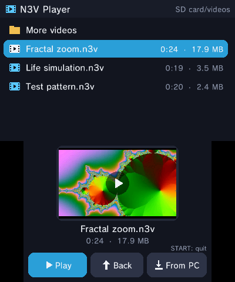
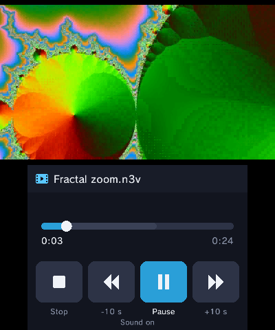
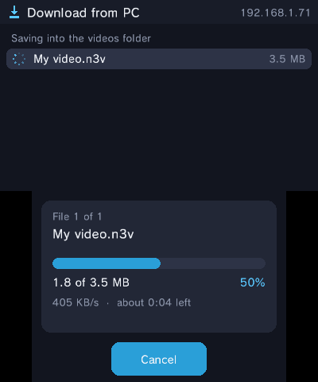

# N3V Player

  

A native video player for the Nintendo 3DS (old and New). Convert any video on your PC into an `.n3v` file, copy it to the SD card, and play it from a simple file browser.

There is no video codec on the 3DS side. The PC does the heavy work up front, and the 3DS only runs cheap native C:

- **Picture:** 400x240, the top screen's own size, as 4x4 two-colour blocks. Only blocks that changed are stored, packed with zlib. The CPU draws them straight into the framebuffer.
- **Sound:** stereo IMA ADPCM at 32728 Hz, decoded by the CPU and streamed to the DSP. The sound's sample clock picks the frame, so picture and sound stay in sync.
- **No pauses:** a reader thread keeps several seconds of video and sound read ahead from the SD card, so a slow read never stalls playback.
- **Seeking:** a keyframe every ~2 seconds.

## Install

Download **`N3VPlayer.zip`** from the [latest release](../../releases/latest) and unzip it. Inside:

- `install_to_3ds.bat`: the easiest way. It opens a page with the steps and sends `N3VPlayer.cia` to FBI on your 3DS over Wi-Fi: scan the page's QR code with FBI's **Remote Install > Scan QR Code**, or pick **Remote Install > Receive URLs over the network** and it finds the 3DS by itself. When the install is done, the page closes and the result shows in the console. (Needs Python; `converter/setup.bat` installs it. Any .cia works: `python install_to_3ds.py other.cia`.)
- `N3VPlayer.cia`: or install it with FBI yourself. Or copy `N3VPlayer.3dsx` to `sdmc:/3ds/` and open it from the Homebrew Launcher. You only need one of the two.
- `converter/`: the video converter (see below).

Sound needs `sdmc:/3ds/dspfirm.cdc`, which most homebrew setups already have (dump it with DSP1 if not).

## Convert a video

**Windows, easiest:** double-click `converter/setup.bat`. The first time, it installs everything the converter needs: Python 3.12 from python.org (only if you don't have Python 3.9+ already), then numpy and imageio-ffmpeg (which brings its own ffmpeg) into a private `.venv` folder beside it. Then it opens the converter window: add videos, see exactly where each `.n3v` will be saved (next to the video, or a folder you pick), choose the picture quality and press **Convert**. Later runs open the window straight away. You can also drag videos onto `setup.bat` or `convert.bat` to start with them in the list.

**Any system, by hand:** needs Python 3.8+ and two packages:

```
pip install numpy imageio-ffmpeg
python converter/n3vconvert.py "my video.mp4"
```

Run it without a file name (or with `--gui video1.mp4 ...`) for the converter window. Anything ffmpeg can read works (MP4, MKV, WebM, AVI...). Videos above 30 fps are halved (60 becomes 30), and the picture is fitted to 400x240 with black bars.

Options: `--quality 1`..`5` (default 3; higher means a better picture and bigger files), `--preview N` saves frame N as the 3DS will show it.

Copy the `.n3v` files anywhere on the SD card. The player starts in `sdmc:/videos/` if that folder exists.

## Controls

The file list is on the **touch screen**: drag it with the stylus to scroll (flick it and it glides), tap a video to select it, and tap it again to play it. The top screen shows a big preview of the selected video. **Back** and **From PC** are in the bar at the top of the touch screen.

| File list | |
|---|---|
| Stylus | scroll, select, tap again to play / open |
| D-pad up/down | move through the list |
| D-pad left/right | highlight the list, **Back** or **From PC** |
| A | press the highlighted thing (play / open the selected item) |
| B | up a folder |
| START | quit |

| Playing | |
|---|---|
| D-pad left/right | highlight **Stop**, **-10 s**, **Pause** or **+10 s** |
| A | press the highlighted button |
| Tap or drag the progress bar | jump there (the picture follows while you drag) |
| D-pad up/down | ahead / back 1 min |
| L / R | back / ahead 10 s |
| B | stop, back to the list |

## Send videos over Wi-Fi

After converting, the converter asks **No / Yes, send it / I don't have N3V Player on my 3DS**. "Yes" opens a window showing your PC's address; on the 3DS tap **From PC**, type that address (it's saved for next time, and later you just pick it from **Choose your PC**) and the videos download into `sdmc:/videos/`. The last choice walks you through installing N3V Player first. You can also send any `.n3v` later with **Send to 3DS...**.

## Build

Needs [devkitPro](https://devkitpro.org/wiki/Getting_Started) (devkitARM, libctru, 3ds-zlib), plus `makerom` and `bannertool` for the CIA.

```
make                                         # N3VPlayer.3dsx
CTRTOOLS=/path/to/tools ./build.sh           # also dist/N3VPlayer.cia
```

`./build.sh autotest` builds a version that plays the first video in the list by itself (handy in an emulator).

## The .n3v format

Described at the top of [`converter/n3vconvert.py`](converter/n3vconvert.py): a 64-byte header, the whole ADPCM soundtrack, the frames (each a length plus zlib data), then a table of keyframe offsets.

To check a file for damage: `python tools/n3vcheck.py video.n3v` lists any broken header values, frames or keyframe entries.

## License

MIT. Only convert videos you have the right to copy.
